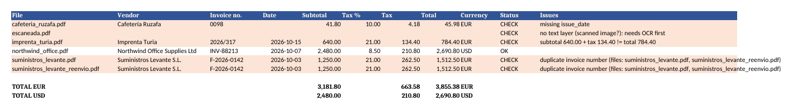

# invoice-extractor

[](https://github.com/elvalenciano1572-create/invoice-extractor/actions/workflows/ci.yml)


Drop a folder of PDF invoices in, get a clean spreadsheet out, with the invoices a person should look at **highlighted instead of silently accepted**.

Typing invoices into a spreadsheet by hand is slow and error-prone. Fully automatic tools are fast but fail quietly: a wrong total or a duplicate invoice goes straight into the books. This tool does the boring part and is loud about anything it isn't sure of.



## What it does

For every PDF in a folder it extracts the **vendor, invoice number, issue date, subtotal, tax rate, tax, total and currency**, writes them to Excel (or CSV), and marks each row **OK** or **CHECK** with the reason:

| Check | Why it matters |
|---|---|
| Subtotal + tax must equal the total (2-cent tolerance) | Catches typos on the invoice and misreads |
| Tax must match the stated rate (e.g. 21% of the subtotal) | Catches wrong VAT before you deduct it |
| Same vendor and invoice number twice | The most common way to pay an invoice twice |
| Missing number, date, vendor or total | Better an empty cell flagged than a guessed value |
| PDF with no text layer | Scanned images are reported for OCR, not skipped |
| Corrupt file | Reported; the rest of the batch still runs |

It reads **English and Spanish** invoices (`Invoice No`, `Nº Factura`, `Base imponible`, `IVA`, …), both number styles (`1,234.56` and `1.234,56`) and common date formats (`2026-10-07`, `03/10/2026`, `15.10.2026`). It ignores due dates when looking for the issue date.

Totals are given **per currency**, never summed across EUR and USD.

## Quick start

```bash
git clone https://github.com/elvalenciano1572-create/invoice-extractor && cd invoice-extractor
python -m venv .venv && source .venv/bin/activate   # Windows: .venv\Scripts\activate
pip install -e ".[dev]"
python examples/make_samples.py          # 6 invented sample invoices
invoice-extract examples/invoices -o invoices.xlsx
```

Output on the samples:

```
6 invoices -> invoices.xlsx  (1 OK, 5 to check)
  !! cafeteria_ruzafa.pdf: missing issue_date
  !! escaneada.pdf: no text layer (scanned image?): needs OCR first
  !! imprenta_turia.pdf: subtotal 640.00 + tax 134.40 != total 784.40
  !! suministros_levante.pdf: duplicate invoice number (files: suministros_levante.pdf, suministros_levante_reenvio.pdf)
  !! suministros_levante_reenvio.pdf: duplicate invoice number (files: suministros_levante.pdf, suministros_levante_reenvio.pdf)
```

The exit code is `0` when every invoice is OK and `1` when something needs checking, so it can run unattended (cron, a shared folder watcher) and alert only when a person is needed. Use `-o invoices.csv` for CSV.

## How it's built

```
src/invoice_extractor/
  pdf.py      PDF -> text (the only module that touches PDFs)
  parser.py   text -> Invoice. Pure functions, no I/O
  models.py   Invoice + validation rules
  batch.py    a whole folder, duplicate detection
  export.py   Excel (formatted, filters, per-currency totals) and CSV
  cli.py      command line
```

Parsing is separated from file handling, so the rules are tested on plain strings and the whole suite runs in under a second: 35 tests, `ruff` clean, CI on Python 3.10 to 3.13.

## Adapting it to a real business

This is a demo with invented invoices. For a real set of suppliers the usual next steps are:

- add the label variants your suppliers actually use (a few lines in `parser.py`, each with a test);
- OCR for scanned invoices;
- write straight to Google Sheets or an accounting tool's API instead of a file;
- watch an email inbox or a shared folder and process invoices as they arrive.

## License

MIT
